# Owner-style border guide: training evidence only

All **95 training approvals were opened and examined**, individually at their rendered size, in 19 batches of five images on 6 November 2026. The recorded viewing interval was 18:05:32–18:09:35 UTC. [Review log](training/review-log.json) lists every image, its timestamp, and the observations; [manifest](training/manifest.json) maps every image to its word ID, page, exact app targets, and approved borders. This is a visual study, not a claim that new guesses are approved.

The original sample's regular pages were sorted; alternating pages `[1::2]` were excluded. Only metadata from that snapshot was extracted. Border coordinates came from public approvals for the remaining 95 IDs. No hidden-test cuts, test evaluation, previous-round hand-back, or test-worst images informed this guide.

Images use immutable page artwork, 400 px ink height, alternating pale spans, thin boundary lines, and the app target list in right-to-left order. Unshaded ink just outside the approved ends is retained as context; it can be a neighbouring stroke, a mark, or a genuine overhang. The numbered target list is separate from the proportional spans.

## Working rules

**1. Find the letter body before allocating a join.** A compact initial tooth or loop usually keeps its compact width. A genuine inserted thin stretch usually goes to the letter on its **left**. In `1.5.1`, the initial nun and ayn remain compact; ba owns the long bridge before dal. `1.1.0` gives sin the broad middle stretch. Do not divide a joined word equally.

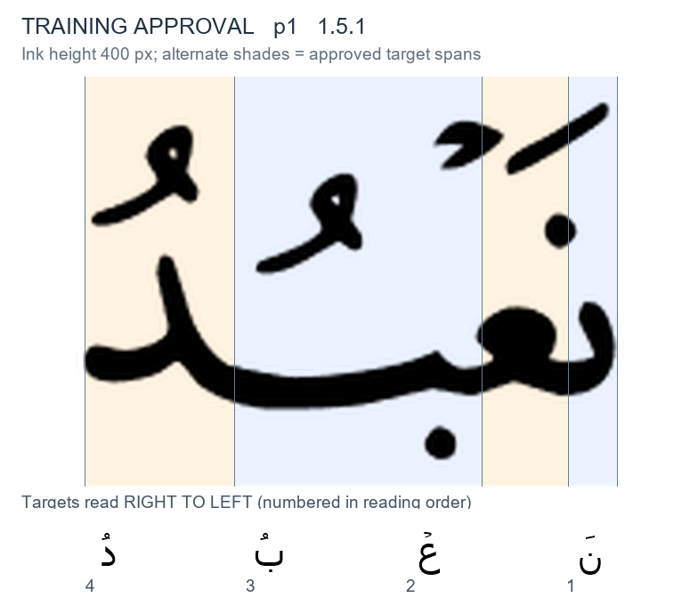

**2. Stacked letters require a useful vertical division, not perfect ink ownership.** In lam–ha of `2.194.1`, the upper lam stem and the ha head overlap horizontally. The approved cut separates their principal positions while crossing the shared head. In stacked ba–mim (`2.4.2`), ba is narrow and the mim/alif target owns the left body. Do not enlarge a letter just to capture every overhanging stroke. Treat new stacked forms as low confidence until checked.

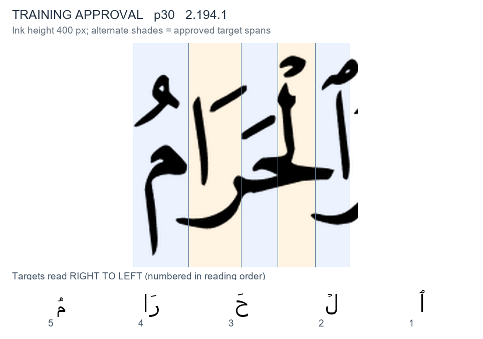

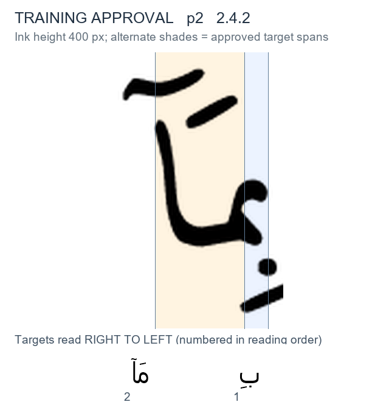

**3. The app targets decide whether a ligature is split.** `2.2.2` has one merged lam-alif target, so the whole ligature has one span. In `2.4.9`, lam and the following hamza-bearing alif are separate targets; the vertical cut passes through their crossing, separating the right upright from the left diagonal. The Allah examples have the app's combined lam target. Never infer the target count from the number of visible stems.

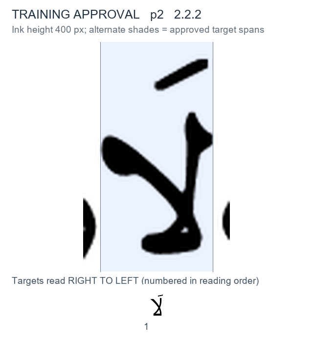

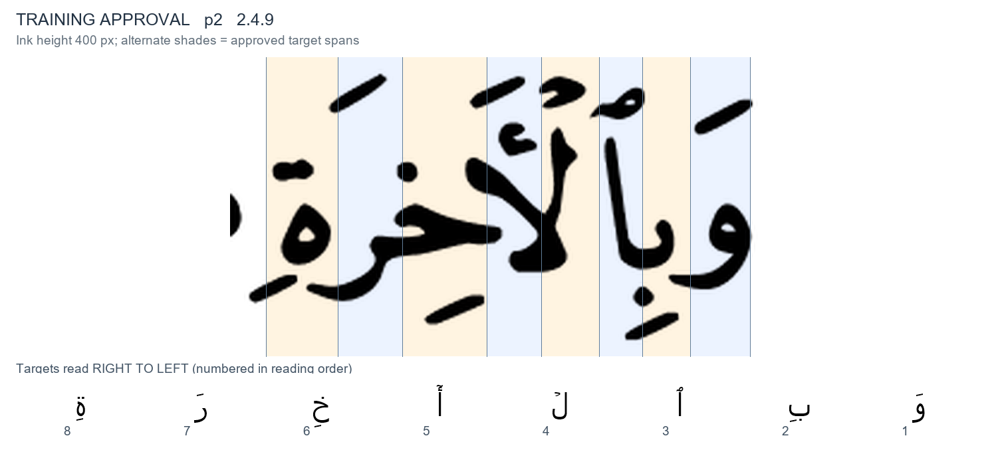

**4. Dots and attached marks identify a letter; they do not pull its border sideways.** Dots, harakat, shadda, hamza above/below a carrier, small alifs, and pause signs often cross a vertical span. Use the carrier body. A standalone app hamza target still needs its own span: this rule does not remove targets. `3.167.19` is a useful carrier-hamza example; the hamza sits below its bridge.

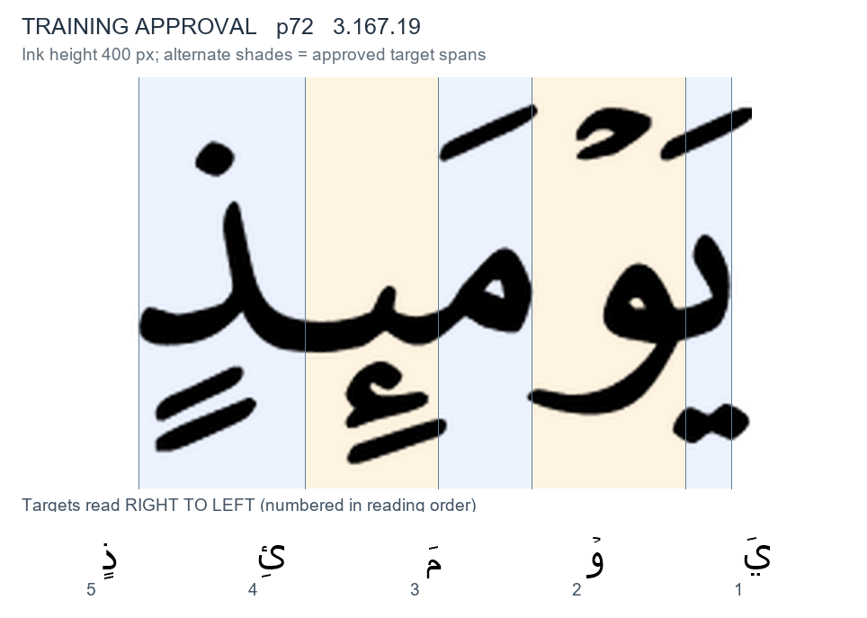

**5. Respect every exact app target, including silent targets and merged madd.** In `2.5.3`, silent nun still gets its entire spatial slot. In `1.7.8`, the merged dad/alif target includes the long alif, with no invented extra division. Use the dumped `tid`, `show`, and `silent` values without linguistic re-segmentation. The exact target list also controls unusual combined forms such as `33.37.41`.

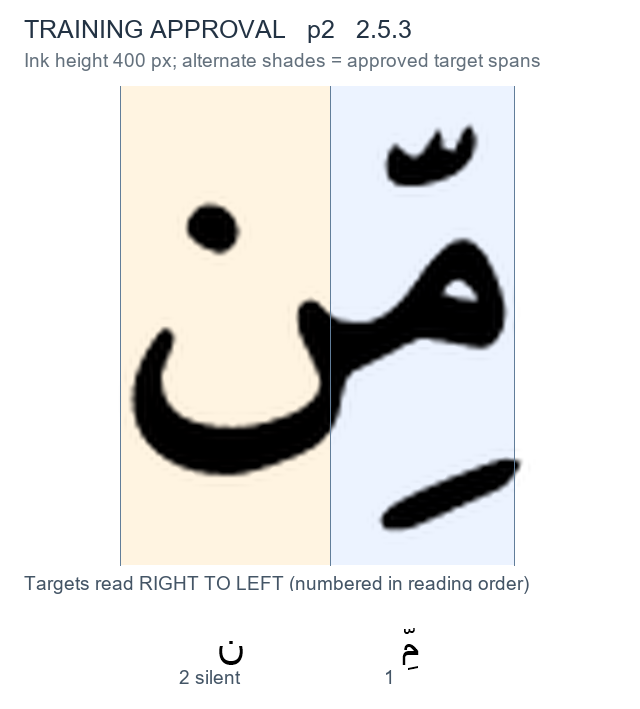

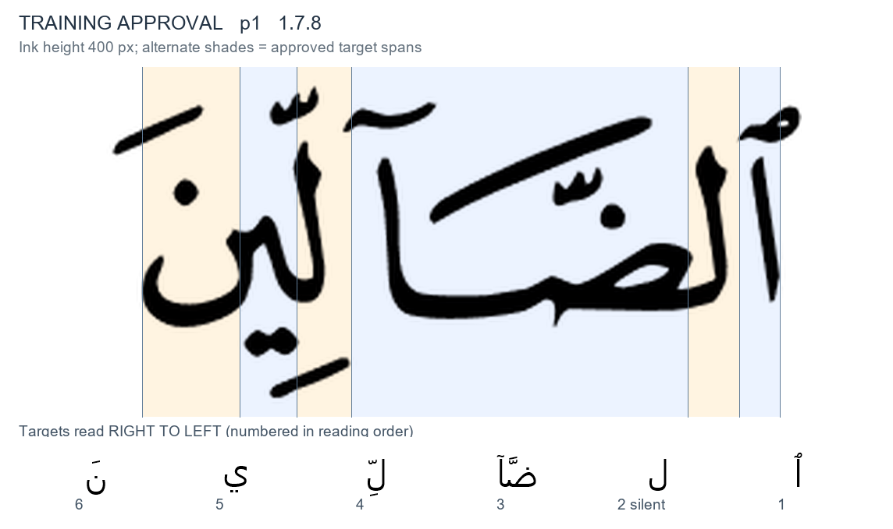

**6. A final bowl or tail can be much wider than its neighbours.** Final nun, ba, ya/maqsura, kaf, and mim keep the leftward extent of their body; do not compress a final nun to its dot. `2.4.7` shows the compact mim head and broad nun bowl. A rightward return underneath earlier letters can cross those earlier spans: the final ayn of `7.203.9` demonstrates why capturing every stroke is impossible with vertical cuts.

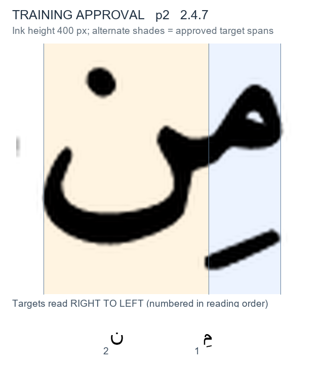

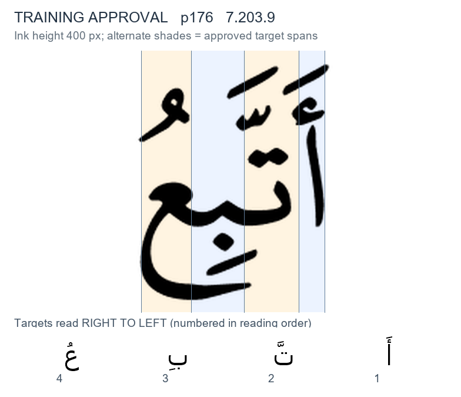

**7. Detached letters still have adjacent spans.** Place a gap boundary between the principal bodies; do not drag it to a displaced dot or a low sweeping tail. `1.2.2` has a ra tail below the adjacent ba; `1.4.1` has a waw tail beneath mim. Preserve the ordered target slots even where ink from detached letters overlaps.

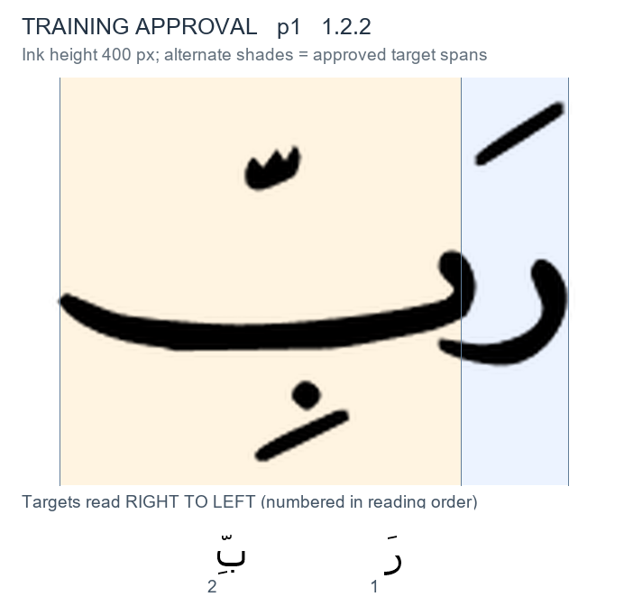

**8. Match the drawing, not just the spelling.** Compare the two rahim words (`1.1.3`, `1.3.1`), the hum words (`2.4.10`, `2.5.6`), and the min examples (`2.4.7`, `7.205.8`, `9.27.3`). Their proportions, tails, and vertical stacking differ. A copied division must be checked on the destination drawing.

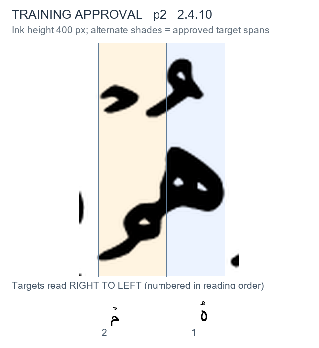

## Questions for the owner

1. **Where is the intended centre of a stacked target?** For lam–ha (`2.194.1`), ba–mim (`2.4.2`), and overlapping lam–maqsura (`2.5.1`), should the short bar favour the upper letter core, the baseline junction, or the perceived whole-letter centre when these disagree?
2. **Which stretches are part of a bowl?** In `6.59.15`, qaf retains most of the long lower stroke before ta marbuta. This looks different from the left-letter kashida rule. Is this a qaf return stroke to preserve, or should new drawings allocate more of it to the following ta?

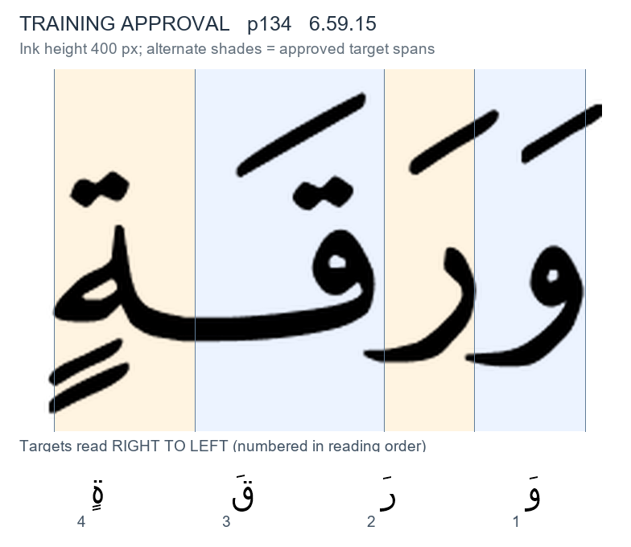

3. **How should unusually narrow approved slots generalise?** `1.7.1` has a narrow dhal slot compared with `2.3.0`; `2.5.5` has a narrow silent waw compared with `2.5.0`. Are these intentional acceptable bar positions, or approvals that should be revisited separately? This guide does not alter them or promote them to universal rules.
4. **Why do some source boxes omit ink?** The approved left edge of `2.3.5` appears to omit part of its final alif stem; `2.193.10` has part of the lam-alif diagonal outside its left span. Are the source review crop/extent or export responsible? The owner resolved the annotation policy: **keep inside the box and flag clipped ink for review**. New outer borders therefore use the visible word-body extent within the immutable box. A wholly absent target body is recorded as a reviewed exception and receives no guess, rather than an invented slot.
5. **Is a visibly plausible range acceptable?** Detached overlapping letters often allow several cuts that keep a short centred bar under the intended core. Should later review record an acceptable interval in addition to the owner's single chosen coordinate? No scoring or approval rule is changed here.

## Confidence and limits

- **Practicality: 90/100.** All 95 images are available, examined, and traceable; the rules provide useful visual anchors.
- **Architecture/data safety: 98/100.** Exact app target IDs were matched against public training approvals. Artwork, approvals, `src/`, and page data were not changed; hidden cuts were not selected or displayed.
- **Visual certainty: 78/100.** Clear cores and tails support the recurring patterns. Stacks, lower return strokes, and a few ambiguous training spans prevent treating this guide as a fully specified production rule. New guesses require the per-word visual check and the independent checkpoint evaluation.

No border decisions for unseen words, owner approvals, or reliability percentages are implied by this study.
